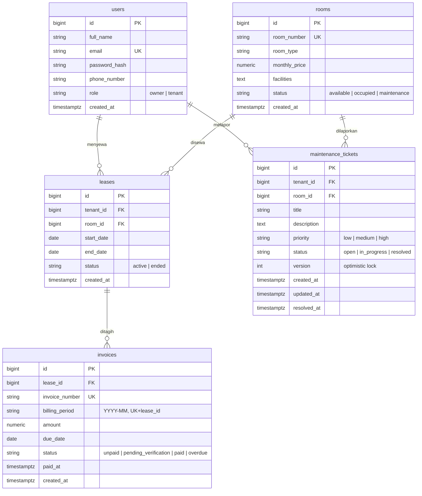

# HuniSpace: Smart Boarding House & Tenant Management Backend

> Go • Fiber v2 • PostgreSQL • JWT • Clean Architecture

**HuniSpace** adalah sistem backend REST API yang mendigitalisasi operasional rumah kos secara terpusat: ketersediaan kamar, kontrak sewa, tagihan dan pembayaran bulanan, serta laporan keluhan fasilitas. Sistem menghubungkan **pemilik kos (owner)** dengan **penghuni (tenant)**.

Repository: `https://github.com/Zelviarani16/hunispace-backend`

---

## Tim

| Anggota | NIM | Peran | Modul |
|---|---|---|---|
| Zelvia Rani F.D.S. | 434241018 | **Git Master**, fondasi, review & merge | Config, database, helper, middleware, route, `users` |
| Drefita Putri C. | 434241016 | Developer | `rooms` dan `leases` |
| Putri Apriliana | 434241022 | Developer | `invoices` dan `maintenance_tickets` |

---

## Latar Belakang

Pengelolaan rumah kos umumnya masih manual: ketersediaan kamar dicatat di buku atau pesan singkat, tagihan bulanan ditagih satu per satu, bukti pembayaran dikirim lewat chat, dan keluhan kerusakan fasilitas mudah terlewat. Akibatnya data tidak terpusat, kamar dapat tersewa ganda, tagihan dapat tercatat dua kali, dan progres perbaikan sulit dipantau oleh penghuni maupun pemilik.

HuniSpace mendigitalisasi proses tersebut lewat REST API yang dapat diintegrasikan ke aplikasi web maupun mobile.

---

## Role dan Hak Akses

| Role | Hak akses |
|---|---|
| **owner** | Mengelola kamar (CRUD), membuat dan mengakhiri kontrak sewa, menerbitkan tagihan, memverifikasi pembayaran, memproses tiket keluhan |
| **tenant** | Melihat kamar, melihat kontrak dan tagihan miliknya, mengonfirmasi pembayaran, membuat dan memantau tiket keluhan |

> Registrasi publik selalu menghasilkan akun **tenant**. Akun **owner** pertama dibuat lewat konfigurasi (`SEED_OWNER_EMAIL` dan `SEED_OWNER_PASSWORD`), bukan lewat endpoint, agar tidak ada yang dapat mendaftarkan diri sebagai owner.

---

## Fitur

| No | Modul | Fitur | Role |
|---|---|---|---|
| 1 | Auth & RBAC | Registrasi, login JWT, profil, pembatasan endpoint berdasarkan role | Semua |
| 2 | Kamar | Tambah, lihat (filter status), ubah sebagian, hapus; status `available` / `occupied` / `maintenance` | Owner (kelola), Tenant (lihat) |
| 3 | Kontrak sewa | Menetapkan penghuni ke kamar dengan rentang tanggal; status kamar berubah otomatis; mengakhiri kontrak | Owner, Tenant |
| 4 | Tagihan | Menerbitkan tagihan per periode; penghuni mengonfirmasi pembayaran dengan bukti; owner memverifikasi | Owner, Tenant |
| 5 | Tiket keluhan | Penghuni melapor kerusakan fasilitas; owner mengubah status `open` → `in_progress` → `resolved` | Tenant (lapor), Owner (proses) |

---

## Arsitektur

Proyek menerapkan **Clean Architecture**. **Tidak ada lapisan controller maupun handler**: fungsi penanganan HTTP berada di dalam `service`, sedangkan `route` hanya mendaftarkan path dan middleware.

```
route → service → repository → database
           │            │
           └─── model ──┘
```

| Lapisan | Folder | Tugas | Tidak boleh |
|---|---|---|---|
| Entity | `app/model` | Struct domain, request, konstanta | Logika bisnis |
| Repository | `app/repository` | Interface + implementasi query pgx | Aturan bisnis, mengenal Fiber |
| Service (usecase + delivery) | `app/service` | Validasi, aturan bisnis, membaca input, membungkus response | Menulis SQL langsung |
| Route | `route` | Mendaftarkan path dan middleware | Logika bisnis |

### Struktur Folder

```
hunispace/
├── main.go                 # bootstrap server, migration, graceful shutdown
├── config/                 # pemuat environment (.env via godotenv)
├── database/               # koneksi pgxpool dan migration runner
├── helper/                 # AppError, response, JWT, bcrypt, parser request
├── middleware/             # RequireAuth, RequireRole, ErrorResponse
├── migrations/             # 001_users … 005_maintenance_tickets
├── route/                  # route.go + satu berkas route per modul
├── app/
│   ├── model/              # user, room, lease, invoice, maintenance, common
│   ├── repository/         # kontrak (interface) dan implementasi per modul
│   └── service/            # service, *_rules.go (aturan murni), _test.go
└── docs/                   # workflow, SOP modul, skema database (detail teknis)
```

> **Pendaftaran route otomatis.** Setiap `*_route.go` mendaftarkan dirinya lewat `init()`. Menambah modul tidak perlu mengubah `main.go` maupun `route.go`, anggota tim tidak saling bentrok di berkas bersama.

---

## Rancangan Database

Lima tabel: dua master (`users`, `rooms`) dan tiga transaksi (`leases`, `invoices`, `maintenance_tickets`). Semua migration idempotent (`IF NOT EXISTS`) dan dijalankan otomatis saat server menyala.


## Pencegahan Race Condition

| Risiko | Skenario | Mitigasi | Letak |
|---|---|---|---|
| **Double booking** kamar | Dua request menetapkan kamar `available` yang sama bersamaan | Transaction + `SELECT ... FOR UPDATE`; cadangan: indeks unik parsial `leases_one_active_per_room` | `lease_service.go`, `003_leases.sql` |
| **Tagihan ganda** per periode | Owner menerbitkan tagihan periode yang sama dua kali | `UNIQUE (lease_id, billing_period)` → 409 `INVOICE_ALREADY_EXISTS` | `004_invoices.sql` |
| **Double submit** pembayaran | Penghuni klik konfirmasi bayar dua kali | `UPDATE ... WHERE status IN ('unpaid','overdue')` — hanya satu request yang mengenai baris | `invoice_repository.go` |
| **Lost update** tiket | Dua pengelola mengubah status tiket yang sama bersamaan | Optimistic locking: `UPDATE ... WHERE id=$1 AND version=$3`; versi basi → 409 `VERSION_CONFLICT` | `maintenance_repository.go` |

---

## Daftar Endpoint

Awalan `/api/v1` kecuali `/health`. Semua response berbentuk `{"success": bool, "message": "...", "data": ...}`.

| Method | Path | Akses | Keterangan |
|---|---|---|---|
| GET | `/health` | Publik | Cek server dan database |
| POST | `/auth/register` | Publik | Registrasi (selalu tenant) |
| POST | `/auth/login` | Publik | Login, mengembalikan JWT |
| GET | `/auth/me` | Login | Profil pengguna |
| GET | `/rooms` | Login | Daftar kamar (`?status=`) |
| GET | `/rooms/:id` | Login | Detail kamar |
| POST | `/rooms` | Owner | Tambah kamar |
| PATCH | `/rooms/:id` | Owner | Ubah kamar (parsial) |
| DELETE | `/rooms/:id` | Owner | Hapus kamar (ditolak bila ada kontrak) |
| POST | `/leases` | Owner | Buat kontrak (transaction + row lock) |
| POST | `/leases/:id/end` | Owner | Akhiri kontrak; kamar kembali `available` |
| GET | `/leases` | Owner | Semua kontrak |
| GET | `/leases/mine` | Tenant | Kontrak milik sendiri |
| POST | `/invoices` | Owner | Terbitkan tagihan |
| GET | `/invoices` | Owner | Semua tagihan |
| GET | `/invoices/mine` | Tenant | Tagihan milik sendiri |
| POST | `/invoices/:id/pay` | Tenant | Konfirmasi pembayaran → `pending_verification` |
| POST | `/invoices/:id/verify` | Owner | Verifikasi pembayaran → `paid` |
| POST | `/tickets` | Tenant | Buat keluhan (kamar dari kontrak aktif) |
| GET | `/tickets/mine` | Tenant | Keluhan milik sendiri |
| GET | `/tickets` | Owner | Semua keluhan |
| PATCH | `/tickets/:id/status` | Owner | Ubah status; wajib sertakan `version` |

---

## Stack Teknologi

| Kebutuhan | Teknologi |
|---|---|
| Bahasa | Go 1.24 |
| HTTP | Fiber v2 |
| Database | PostgreSQL via pgx v5 (`pgxpool`) |
| Autentikasi | JWT HS256 + bcrypt |
| Konfigurasi | godotenv |

---

## Cara Menjalankan

Prasyarat: **Go** dan **PostgreSQL** (lokal atau Supabase).

```powershell
# 1. Salin file konfigurasi
Copy-Item .env.example .env

# 2. Isi .env — wajib diisi:
#    DB_HOST, DB_PORT, DB_USER, DB_PASSWORD, DB_NAME
#    JWT_SECRET (minimal 32 karakter)
#    SEED_OWNER_EMAIL, SEED_OWNER_PASSWORD (untuk akun owner pertama)
notepad .env

# 3. Buat database
psql -U postgres -c "CREATE DATABASE hunispace;"

# 4. Jalankan (migration otomatis saat AUTO_MIGRATE=true)
go mod tidy
go test ./...
go run .
```

Cek server berjalan:

```powershell
Invoke-RestMethod http://localhost:3000/health
```

Uji registrasi dan login:

```powershell
$body = @{ full_name = "Budi"; email = "budi@example.com"; password = "rahasia123" } | ConvertTo-Json
Invoke-RestMethod -Method Post -Uri http://localhost:3000/api/v1/auth/register -ContentType "application/json" -Body $body

$login = @{ email = "budi@example.com"; password = "rahasia123" } | ConvertTo-Json
$res = Invoke-RestMethod -Method Post -Uri http://localhost:3000/api/v1/auth/login -ContentType "application/json" -Body $login

# Akses endpoint dengan token
Invoke-RestMethod -Uri http://localhost:3000/api/v1/rooms -Headers @{ Authorization = "Bearer $($res.data.access_token)" }
```

---

## Alur Git

```
main (commit awal) → feat/core-auth (Zelvia, PR #1)
                   → feat/room-lease (Drefita, PR #2)
                   → feat/invoice-maintenance (Putri, PR #3)
                   → docs/project-docs (Zelvia, PR #4)
```

- Setiap anggota bekerja di branch sendiri dengan **micro commit** (1 commit = 1 perubahan kecil).
- Semua perubahan ke `main` wajib lewat **Pull Request**.
- Git Master mereview (`go build`, `go vet`, `go test`) lalu merge dengan **Create a merge commit**, bukan Squash. Hal tersebut agar commit tiap anggota tetap terlihat di riwayat.
- Urutan merge mengikuti ketergantungan: fondasi → rooms+leases → invoices+maintenance.

Konvensi commit: `type(scope): deskripsi`. Contoh:
```
feat(lease): add lease service with transaction and row lock against double booking
test(invoice): add table-driven tests for billing period validation
docs(readme): add project description, features, roles, and database design
```