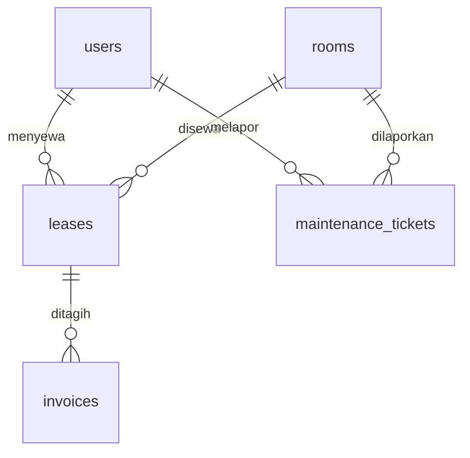

# Skema Database

Lima tabel utama. Semua `id` bertipe `BIGSERIAL`. Seluruh migration idempotent (`IF NOT EXISTS`) dan dijalankan berurutan menurut nama berkas.

## users (`001_users.sql`)

| Kolom | Tipe | Keterangan |
|---|---|---|
| id | BIGSERIAL PK | |
| full_name | VARCHAR(100) | |
| email | VARCHAR(150) UNIQUE | disimpan huruf kecil |
| password_hash | VARCHAR(100) | bcrypt, tidak pernah dikirim ke klien |
| phone_number | VARCHAR(20) | |
| role | VARCHAR(10) | `owner` atau `tenant` (CHECK) |
| created_at | TIMESTAMPTZ | |

## rooms (`002_rooms.sql`)

| Kolom | Tipe | Keterangan |
|---|---|---|
| id | BIGSERIAL PK | |
| room_number | VARCHAR(20) UNIQUE | |
| room_type | VARCHAR(50) | |
| monthly_price | NUMERIC(12,2) | CHECK > 0 |
| facilities | TEXT | |
| status | VARCHAR(12) | `available`, `occupied`, `maintenance` (CHECK) |
| created_at | TIMESTAMPTZ | |

## leases (`003_leases.sql`)

| Kolom | Tipe | Keterangan |
|---|---|---|
| id | BIGSERIAL PK | |
| tenant_id | BIGINT FK → users | |
| room_id | BIGINT FK → rooms | |
| start_date, end_date | DATE | CHECK end_date > start_date |
| status | VARCHAR(10) | `active`, `ended` |
| created_at | TIMESTAMPTZ | |

Indeks unik parsial `leases_one_active_per_room ON (room_id) WHERE status = 'active'`: satu kamar hanya boleh punya satu kontrak aktif, bahkan bila kode aplikasi lolos dari pemeriksaan.

## invoices (`004_invoices.sql`)

| Kolom | Tipe | Keterangan |
|---|---|---|
| id | BIGSERIAL PK | |
| lease_id | BIGINT FK → leases | |
| invoice_number | VARCHAR(40) UNIQUE | mis. `INV-202611-12-A1B2C3` |
| billing_period | VARCHAR(7) | `YYYY-MM` |
| amount | NUMERIC(12,2) | CHECK > 0 |
| due_date | DATE | |
| payment_method, proof_url | VARCHAR(30), TEXT | boleh NULL sampai dibayar |
| status | VARCHAR(22) | `unpaid`, `pending_verification`, `paid`, `overdue` |
| paid_at | TIMESTAMPTZ | NULL sampai diverifikasi |
| created_at | TIMESTAMPTZ | |

`UNIQUE (lease_id, billing_period)` mencegah tagihan ganda untuk periode yang sama.

## maintenance_tickets (`005_maintenance_tickets.sql`)

| Kolom | Tipe | Keterangan |
|---|---|---|
| id | BIGSERIAL PK | |
| tenant_id | BIGINT FK → users | |
| room_id | BIGINT FK → rooms | diambil dari kontrak aktif penghuni |
| title, description | VARCHAR(150), TEXT | |
| priority | VARCHAR(10) | `low`, `medium`, `high` |
| status | VARCHAR(12) | `open`, `in_progress`, `resolved` |
| version | INT | bertambah tiap update (optimistic locking) |
| created_at, updated_at | TIMESTAMPTZ | |
| resolved_at | TIMESTAMPTZ | terisi saat status `resolved` |

Kolom `version` dan `updated_at` ditambahkan di luar rancangan awal sebagai dasar optimistic locking.

## Catatan rancangan

- Nilai uang memakai `NUMERIC(12,2)`. Di Go dipetakan ke `float64` untuk kesederhanaan boilerplate; untuk produksi sebaiknya memakai tipe desimal.
- Status `overdue` pada invoice belum diatur otomatis. Dapat ditambahkan nanti lewat job terjadwal.
